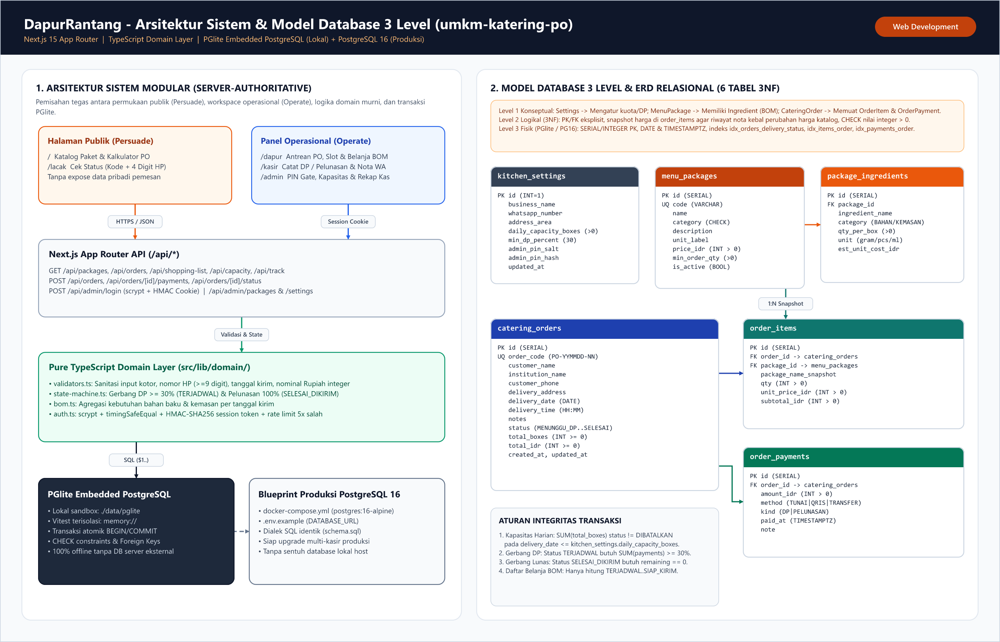
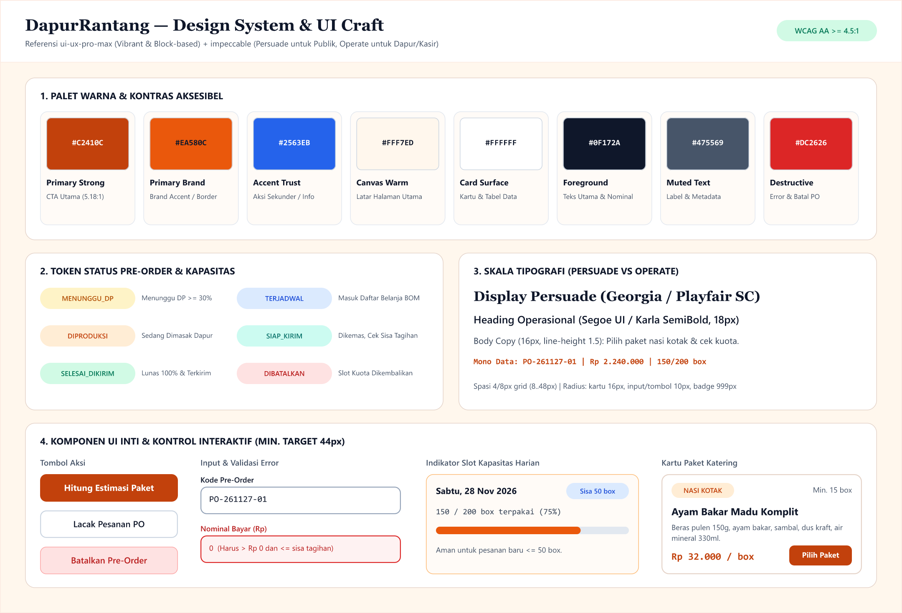
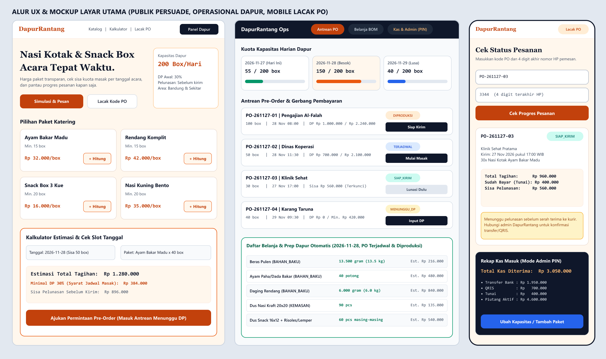

# DapurRantang (`umkm-katering-po`)

Aplikasi web manajemen pre-order katering nasi kotak dan snack box untuk UMKM kuliner. Sistem ini menggabungkan halaman katalog publik dan kalkulator estimasi biaya dengan panel operasional dapur, kasir, dan kontrol admin berbasis PostgreSQL lokal (PGlite).

## Masalah yang Diselesaikan

1. **Kuota dapur harian**: Mencegah bentrok jadwal dan kelebihan kapasitas masak dengan mengunci batas `daily_capacity_boxes` (default 200 box per tanggal kirim) di dalam transaksi database.
2. **Gerbang DP dan pelunasan**: Pesanan baru berstatus `MENUNGGU_DP` baru bisa masuk jadwal masak (`TERJADWAL`) setelah total bayar mencapai minimal DP (default 30%), dan tidak dapat diselesaikan ke `SELESAI_DIKIRIM` sebelum sisa tagihan bernilai Rp 0.
3. **Rekap belanja bahan otomatis (BOM)**: Menggabungkan takaran bahan baku dan kemasan dari seluruh pesanan aktif (`TERJADWAL`, `DIPRODUKSI`, `SIAP_KIRIM`) pada rentang tanggal kirim menjadi satu daftar belanja harian.
4. **Pelacakan PO tanpa bocor data pribadi**: Pemesan mengecek status pesanan lewat `/lacak` menggunakan kode PO dan 4 digit terakhir nomor HP.

## Rute Utama

| Rute | Pengguna | Fungsi |
| :--- | :--- | :--- |
| `/` | Pelanggan & Panitia | Katalog paket aktif, filter kategori, kalkulator estimasi total/DP 30%, cek sisa slot tanggal, dan ajukan PO. |
| `/lacak` | Pelanggan & Panitia | Lacak progres produksi, jadwal antar, catatan kurir, dan sisa pelunasan via kode PO + 4 digit HP. |
| `/dapur` | Staf Dapur | Strip kuota harian, antrean PO, transisi status, salin nota WhatsApp, dan tab Daftar Belanja BOM per rentang tanggal. |
| `/kasir` | Kasir | Pencatatan pembayaran bertahap (`TUNAI`, `QRIS`, `TRANSFER`), isi cepat nominal DP/sisa, dan konfirmasi serah terima. |
| `/admin` | Pemilik UMKM | Login PIN terproteksi `scrypt` + cookie HMAC `HttpOnly` + rate limit 5x salah, rekap kas, daftar piutang belum lunas, pengaturan kapasitas/DP/PIN, serta kelola katalog & BOM. |

## Desain Sistem & Arsitektur (FigCraft)

File sumber desain tersedia di [docs/design/design.figcraft](docs/design/design.figcraft).

### Arsitektur & ERD 3 Level


### Design System


### Mockup Layar Publik, Operasional Dapur & Mobile Lacak PO


## Menjalankan Secara Lokal (PGlite Embedded, Tanpa Instalasi Database)

```bash
npm run dev
```

Aplikasi berjalan di `http://localhost:3000`. Pada boot pertama, skema PostgreSQL dan data simulasi UMKM (5 paket menu + 5 pre-order) otomatis dibuat di `./data/pglite`.

- PIN Admin demo bawaan untuk lingkungan lokal: `271127` (dapat diganti lewat halaman `/admin` atau variabel lingkungan `DAPUR_ADMIN_PIN`).

## Verifikasi & Pengujian

```bash
npm test
npm run typecheck
npm run build
```

Cakupan tes Vitest (`30` skenario di 5 berkas tes) berjalan terisolasi di `PGlite("memory://")`:
- `tests/domain.test.ts`: validasi nomor HP, tanggal kalender, aritmetika integer DP 30%, state machine gerbang DP/pelunasan, agregasi BOM, hashing PIN `scrypt`, token HMAC, dan rate limiter.
- `tests/repo.test.ts`: inisialisasi idempoten, kunci kapasitas harian, pengembalian kuota saat batal, pembayaran bertahap, pelacakan publik `/lacak`, dan pembaruan katalog/pengaturan.
- `tests/edge-cases.test.ts`: tanggal kabisat vs non-kabisat, payload `initialPayment` negatif/nol, penggabungan item duplikat, kapasitas diturunkan di bawah pemakaian, injeksi SQL, dan nominal pecahan.
- `tests/api.test.ts`: route handlers `/api/*`, penyamaran nomor HP saat unauthenticated, penolakan payload JSON non-objek, dan proteksi sesi Admin.
- `tests/db.test.ts`: smoke test DDL dan query `RETURNING` pada PGlite.

## Konfigurasi Produksi (PostgreSQL 16 via Docker)

Salin `.env.example` menjadi `.env`, sesuaikan `SESSION_SECRET` dan kredensial database, lalu jalankan PostgreSQL 16 menggunakan skema di [db/schema.sql](db/schema.sql):

```bash
cp .env.example .env
docker compose up -d
```
